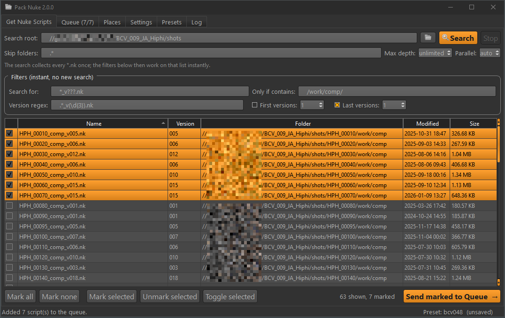
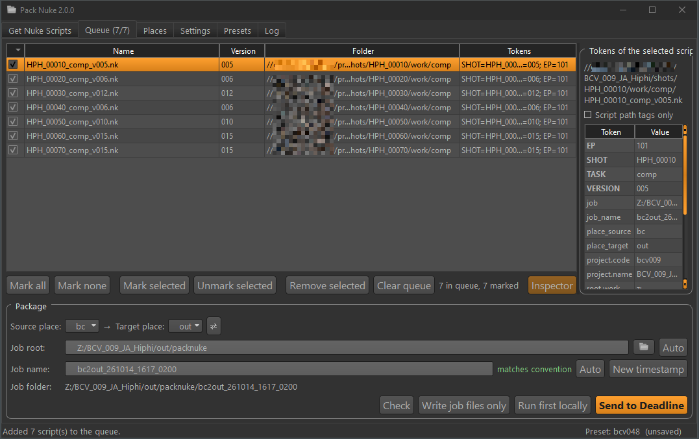
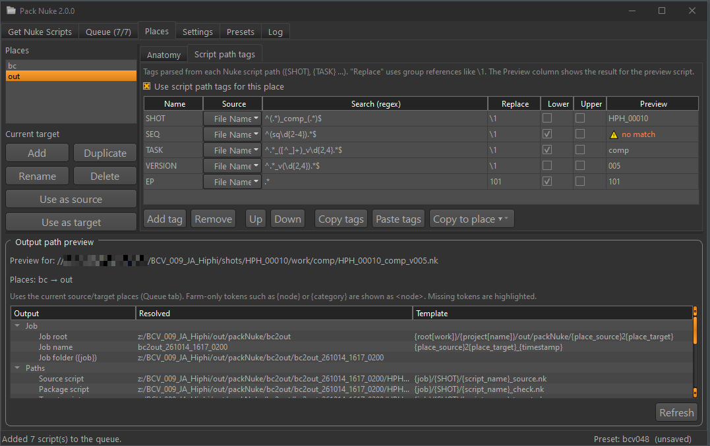
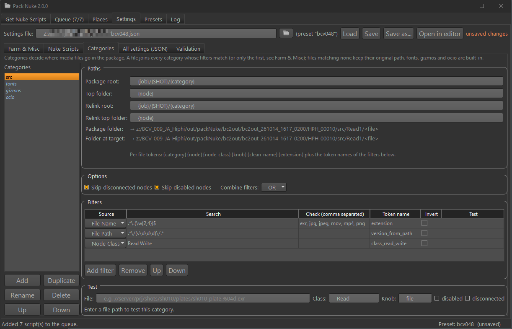

# Pack Nuke

Pack Nuke collects every file a Nuke script needs (read media, fonts, gizmos, OCIO config),
copies it into a **package** with a folder structure you define, and saves **relinked**
copies of the script, so the script works at another place. It is built for studio to studio
exchange and runs on the Deadline farm, one job per script.

There are three ways to use it:

| | entry point | use it for |
|---|---|---|
| **GUI** | `pack_nuke_gui.py` | find scripts, build a queue, edit settings and places, preview paths, submit |
| **Command line** | `pack_nuke_cli.py` | pack from scripts and pipelines; prints the package root |
| **Farm job** | `pack_nuke.py` (inside `nuke -t`) | packs one script; started by Deadline, or locally |

```
GUI / command line                         Deadline (one job per script)
──────────────────────────                 ─────────────────────────────────────────────
pick scripts + places                      nuke -t pack_nuke.py --job-dir … --id …
  → checks (templates, places, ...)          → open script, scan knobs / fonts / gizmos / OCIO
  → write <package>/_pack_nuke/              → pack plan (categories, targets, duplicates)
       settings.json, job.json               → parallel copy (atomic, skips identical files)
  → submit                                   → save source / package / target scripts
                                             → report CSV + JSON, non-zero exit on failure
```

---

## Quick start

Requirements:

* **GUI and command line:** Python 3.9+. The GUI also needs PySide6.
* **Farm:** Nuke 13+ (Python 3.9+) and Deadline. `deadlinecommand` must be reachable from the
  machine that submits.

With [uv](https://docs.astral.sh/uv/), run these from the repository folder:

```powershell
# GUI
uv run --no-project --python 3.11 --with PySide6 python pack_nuke_gui.py

# command line
uv run --no-project --python 3.11 python pack_nuke_cli.py --help

# tests (no Nuke, Qt or Deadline needed)
uv run --no-project --python 3.11 python -m unittest discover -s tests
```

Plain Python works as well: `pip install PySide6`, then `python pack_nuke_gui.py`.

Setting up a new studio:

1. Open the GUI. It loads `settings.json` from the app folder.
2. **Settings → Farm & Misc**: set the Nuke executable, `deadlinecommand` and the farm path of
   `pack_nuke.py`, for each OS.
3. **Places**: define the source and target places and their anatomy and script path tags.
4. **Settings → Nuke Scripts / Categories**: decide where scripts and files go in the package.
5. **Presets**: save everything as a preset. The preset now holds the settings.

---

## Concepts

### Places

A *place* is a studio or site that sends or receives packages (e.g. `bc` and `out`). Each place
has:

* **anatomy**: free key/value tokens, which may be nested, e.g. `project.name`, used as
  `{project[name]}`.
* **script path tags**: regexes that pull tokens out of each Nuke script's file name or path,
  e.g. `{SHOT}`, `{TASK}`, `{VERSION}`.

For a package you pick a **source** and a **target** place. Templates use the source place's
anatomy and tags.

### Tokens and templates

Every path in the settings is a template such as `{job}/{SHOT}/{category}/{node}`. Nested
anatomy is written as `{project[name]}`.

| token | from |
|---|---|
| anatomy keys (`project`, `root`, `studio`, ...) | source place anatomy |
| `place_source`, `place_target`, `timestamp` | the package. The timestamp is UTC `YYMMDD_HHMM_` + local offset |
| script path tags (`SHOT`, `TASK`, ...) | source place `script_path_tags` |
| `script_path`, `script_dir`, `script_file`, `script_name` | the Nuke script |
| `job_name`, `job` | package name and full package folder |
| `category`, `node`, `node_class`, `knob`, `clean_name`, `extension` | per file, known on the farm only |
| filter token names (e.g. `extension`, `version_from_path`) | category filters |
| `font` (fonts), `class` (gizmos) | built-in categories |

The GUI shows farm-only tokens as `<node>`. On the farm a missing token is an error: the job
fails and the report names the token.

### Package and job

The **package root** (job folder) is `job_root / job_name`. Both come from templates in the
`job` settings section and are available as `{job}` in other templates.

### Categories

Categories decide **where media files go** inside the package. Each category has:

* **filters** that match a file by file name, file path, node class or knob name. Each filter
  is a regex (group 1 is the value), with an optional check list, an invert flag, and an
  optional token name.
* **filter options**: skip disabled or disconnected nodes, and combine the filters with AND or OR.
* **path templates**: a package root and top folder, and the relink root and top folder at the
  target place.

A file joins every matching category, or only the first one if *category match = first*.
Files that match no category are not packed and keep their original path; the report shows
them as `uncategorized`.

**fonts**, **gizmos** and **ocio** are **built-in categories**. Their names are fixed and they
have no filters, because the scan decides what they contain. Their folders and options are
editable:

* **all three:** pack on/off.
* **fonts, gizmos:** skip disabled/disconnected nodes.
* **gizmos:** convert gizmos to groups.
* **ocio:** relative config path, plus a *max files* safety limit.

### The three Nuke scripts

| script | what it is |
|---|---|
| **source** | an untouched copy of the original |
| **package** | relinked to the copies inside the package |
| **target** | relinked to the `*_relink` locations, i.e. where the files will live at the receiving place. Relative paths are computed from `path_relink`, the script's future location. |

Each script can be switched off. Links can be absolute, or relative to a project directory.
That directory is the script folder, N folders above it, or a custom template; the script's
`project_directory` is set to match.

---

## GUI

### Get Nuke Scripts



* **Search** walks the search root once and collects every `*.nk`. Rows appear while folders
  are listed, and the status bar shows progress. **Stop** or `Ctrl+.` stops the search.
* **Speed controls:**
  * **Skip folders** (`render;plates;.*`, wildcards) is the biggest speed-up on production trees.
  * **Max depth** limits how deep the walk goes.
  * **Parallel**: `auto` uses 1 thread on local disks and 16 on network shares, where parallel
    listing is many times faster.
* **Filters** work on the list already found, so they are instant:
  * *Search for*: name patterns, `;` separated.
  * *Only if contains*: path text.
  * *Version regex*: group 1 is the version.
  * *First / Last N versions*: per folder.
* **Marking:** highlight rows (Shift/Ctrl click), then **Mark / Unmark / Toggle selected**
  (Space). The right-click menu also offers reveal and copy path. Double click opens the folder.
* **Send marked to Queue** adds the marked scripts; scripts already in the queue are skipped.

### Queue



* **Table:** the scripts to pack, with their script path tags in the *Tokens* column. Only
  marked rows are packed. Del removes rows.
* **Inspector:** a resizable, hideable side panel listing every token of the highlighted script,
  one per line.
* **Package:**
  * Source and target place, with a swap button.
  * Job root and job name. **Auto** resets them to the settings templates; **New timestamp**
    refreshes the time in the name. The job name is checked live against `job.job_name_check`.
  * **Check** runs every check without writing anything.
  * **Write job files only** creates the package folder and job files without submitting.
  * **Run first locally** packs the first script with the local Nuke and streams its output
    into the Log tab.
  * **Send to Deadline** submits one job per script, under one batch name.

### Places



* **Places list:** add, duplicate, rename or delete places, and use one as the source or target.
* **Anatomy:** a key/value table where nested keys use dots (`project.name`).
* **Script path tags:** each tag has a name, source (file name or path), regex, replace (`\1`)
  and lower/upper case. The *Preview* column shows each tag's value for the preview script.
  Likely typos are flagged with ⚠: `/1` instead of `\1`, `{2-4}` instead of `{2,4}`, or tags
  switched off.
* **Copy and paste:** rows can move between places with Copy/Paste (`Ctrl+C` / `Ctrl+V`,
  through the clipboard) or **Copy to place ▾**.
* **Output path preview:** every template resolved for the preview script, i.e. the first
  highlighted Queue item, or the first highlighted found script if the queue is empty. Missing
  tokens are highlighted.

### Settings



Settings come from the **loaded preset**, with the settings embedded in it. Before any preset
is loaded they come from `settings.json` in the app folder. The file field shows which one is
in use.

* **Save** (`Ctrl+S`) writes back into that preset, or into that file.
* **Save as...** writes a plain `settings.json`.
* **Load** accepts a settings.json or a preset file.

| sub-tab | |
|---|---|
| **Farm & Misc** | Nuke / deadlinecommand / farm `pack_nuke.py` per OS; Deadline pool, group, priority, department, limits, comment; packing options: copy threads, skip identical files, hashes, category match, fail on missing files, include Write nodes, colour relinked nodes |
| **Nuke Scripts** | source / package / target script: on/off, paths, path at target, relative linking. Each path is shown resolved. |
| **Categories** | add / duplicate / rename / delete / reorder; path templates with the resolved package and target folder; options; filters table; a **Test** box (file path, class, knob) showing each filter's hit/value and whether the category matches. Built-in categories show their own options. |
| **All settings (JSON)** | every value, editable; types are preserved |
| **Validation** | errors and warnings: invalid regexes, typos, missing templates, ... |

### Presets

* A preset is a JSON file in the **presets folder**, which is stored in `settings.ini` as
  `presets_folder` (default `./presets`). Use a shared folder to share presets between artists.
* A preset always contains the **complete settings**, plus the search root, skip folders,
  depth, filters, version regex, first/last N and the source/target place.
* Loading or saving a preset makes it the settings source, so the Settings tab saves into it.
* The last preset is restored on start. Your last session's search and filter fields stay on top
  of it.
* **Default source place** is selected when settings are loaded.

### Log

All application messages, filtered by minimum level and text, with colour per level. Messages
can be cleared or saved. Errors also appear in the status bar. A rotating
`pack_nuke_gui.log` is written next to the app.

Every control has a tooltip; hover for help.

---

## Command line

`pack_nuke_cli.py` packs scripts without the GUI. It uses the same settings, presets, checks and
Deadline submission as the GUI. On success it prints **only the package root folder** on stdout,
so a script or pipeline can capture it. Progress and problems go to stderr.

### What you need

* **Settings:** either a preset (`--preset`) or a settings.json (`--settings`). Without either,
  `settings.json` next to the app is used.
* **Nuke scripts:** as arguments, and/or in a text file (`--list`).
* **Places:** a source and a target place (`--source`, `--target`). If the preset was saved
  with places selected, these can be left out.

### Examples

```powershell
# one script, Deadline (the default mode)
python pack_nuke_cli.py --preset bcv048 --source bc --target out Z:/prj/shots/sh010/work/comp/sh010_comp_v003.nk

# many scripts from a list file, places taken from the preset
python pack_nuke_cli.py --preset bcv048 --list scripts.txt

# preset given as a file, plain settings.json instead of a preset
python pack_nuke_cli.py --preset Z:/_tech/pack_nuke_presets/bcv048.json --list scripts.txt
python pack_nuke_cli.py --settings D:/pack/settings.json --source bc --target out --list scripts.txt

# pack on this machine with the local Nuke, one script after another (no Deadline)
python pack_nuke_cli.py --preset bcv048 --list scripts.txt --mode local

# only create the package job files; submit later or inspect them
python pack_nuke_cli.py --preset bcv048 --list scripts.txt --mode write

# validate everything and show where the package would go, without writing anything
python pack_nuke_cli.py --preset bcv048 --list scripts.txt --check

# fixed package folder instead of the settings templates
python pack_nuke_cli.py --preset bcv048 --list scripts.txt --job-root Z:/exchange/out --job-name bc2out_delivery_01
```

With uv, prefix the same command: `uv run --no-project --python 3.11 python pack_nuke_cli.py ...`.

### Script list file

One Nuke script per line. Blank lines and lines starting with `#` are ignored, and quotes around
a path are allowed. `--list` can be given several times, and scripts listed twice are packed once.

```text
# HPH delivery 2026-10-14
//server/prj/BCV_009/shots/HPH_00010/work/comp/HPH_00010_comp_v005.nk
"//server/prj/BCV_009/shots/HPH_00020/work/comp/HPH_00020_comp_v006.nk"
```

### Options

| option | |
|---|---|
| `--preset NAME\|FILE` | a preset. A name is looked up in `presets_folder` from `settings.ini`, or in `--presets-folder DIR` |
| `--settings FILE` | a plain settings.json (default: `settings.json` next to the app) |
| `scripts...` | Nuke scripts as arguments |
| `--list FILE` | a text file with one script path per line; repeatable |
| `--source`, `--target` | places; default: the ones saved in the preset |
| `--job-root DIR`, `--job-name NAME` | override the settings templates `job.job_root` / `job.job_name_default` |
| `--version-regex RX` | version shown in `nuke_files.csv`; default: the preset's version regex |
| `--mode submit\|local\|write` | `submit` (default) sends one Deadline job per script. `local` runs `nuke -t` here, one script after another. `write` only creates the job files. |
| `--check` | only run the checks for the chosen mode; prints the package root |
| `--json` | print a JSON summary on stdout instead of the root |
| `-v`, `-q` | more / less output on stderr |

### Output and exit codes

| exit code | meaning | stdout |
|---|---|---|
| `0` | OK | the package root |
| `1` | a Deadline submission or a local pack failed | the package root; look in its `_pack_nuke/reports/` |
| `2` | bad input, or the checks found problems; nothing was written | empty |

With `--json` stdout always holds a summary:

```json
{
  "package_root": "Z:/BCV_009/out/packNuke/bc2out/bc2out_261014_1617_0200",
  "job_name": "bc2out_261014_1617_0200",
  "place_source": "bc", "place_target": "out", "mode": "submit",
  "scripts": [{"id": "0000_HPH_00010_comp_v005", "path": "//server/.../HPH_00010_comp_v005.nk"}],
  "problems": [],
  "submitted": [{"id": "0000_HPH_00010_comp_v005", "ok": true, "job_id": "6710...", "error": ""}],
  "exit_code": 0
}
```

### Using it from scripts

```powershell
# PowerShell
$pkg = python pack_nuke_cli.py --preset bcv048 --list scripts.txt
if ($LASTEXITCODE -eq 0) { Write-Host "package: $pkg" } else { Write-Host "failed ($LASTEXITCODE)" }
```

```bat
:: cmd.exe
for /f "delims=" %%p in ('python pack_nuke_cli.py --preset bcv048 --list scripts.txt') do set PKG=%%p
echo %PKG%
```

```python
# Python
import subprocess
res = subprocess.run(['python', 'pack_nuke_cli.py', '--preset', 'bcv048', '--list', 'scripts.txt'],
                     capture_output=True, text=True)
package_root = res.stdout.strip() if res.returncode == 0 else None
```

---

## Farm job

```
nuke -t pack_nuke.py --job-dir <package>/_pack_nuke --id <script id> [--dry-run] [--verbose]
```

The GUI and the command line submit exactly this, as a Deadline CommandLine job. The job and
plugin info files are kept in `_pack_nuke/deadline/`.

1. Read `job.json` and `settings.json` from the package. Invalid settings stop the job with exit code 2.
2. Open the script. A script that loads with errors, e.g. missing plugins, is still packed.
3. Record the gizmos, then convert them to groups if that option is on; inputs and outputs are
   reconnected and nested gizmos are handled.
4. Scan:
   * every File_Knob of every node, including inside groups and on proxy knobs;
   * FreeType fonts;
   * the OCIO config (`$OCIO` or a custom config);
   * loaded plugins, which are reported only.
5. **Pack plan:**
   * Sequences (`%04d`, `####`, `%d`) and stereo (`%V`, `%v`) are matched exactly against the
     files on disk.
   * Duplicates (the same files read by several nodes) are copied once.
   * Write-type nodes are skipped unless enabled.
   * Two different files mapped to the same target are reported as a **collision**; neither
     overwrites the other.
6. **Copy:** in parallel, written to a temporary name and then renamed, so jobs sharing a
   folder can't corrupt each other. Identical files are skipped, so re-running is cheap.
   Optionally each file is hashed (blake2b) during the copy.
7. Save the source, package and target scripts; relinked nodes are optionally coloured. Fonts
   are relinked through the project font path; OCIO through `customOCIOConfigPath`.
8. **Report:** always written. The exit code is `1` if anything failed, so Deadline shows the
   failure. Missing source files fail the job only with `packing.fail_on_missing`.

`--dry-run` builds the plan and writes the report without copying or saving anything.

---

## Package layout

```
<job root>/<job name>/                      ← package root ({job})
  _pack_nuke/
    settings.json        settings used for this package
    job.json             places, timestamp, every script with all its tokens
    nuke_files.csv       readable index of the scripts
    deadline/            submitted job / plugin info files
    reports/<id>.csv     one row per item (see below)
    reports/<id>.json    summary (errors, warnings, written scripts, stats) + the full plan
  …                      everything else is defined by your templates
```

Report statuses:

| status | meaning |
|---|---|
| `ok` | packed |
| `duplicate` | same files as another node; relinked to that node's copy |
| `missing` | no files on disk |
| `uncategorized` | no category matched; left pointing at the original path |
| `skipped` | disabled/disconnected per options, Write-type node, or category switched off |
| `error` | copy failure, collision, missing template token, ... |

Report columns:

* status, reason, copy status;
* categories, colour / font info;
* node class, node, knob;
* file name, extension, file count, frame ranges, size;
* disabled / disconnected flags;
* source, package path and relink path;
* hashes, duplicate-of, places and timestamp.

---

## Settings reference (`settings.json`, schema 3)

The `_comment` keys in `settings.json` explain each section. Missing keys get defaults, and
older files are migrated when loaded (see below).

| section | keys |
|---|---|
| `job` | `job_root`, `job_name_default`, `job_name_check` (regex) |
| `nuke_scripts` | `source` / `package` / `target`: `copy`, `path`, `path_relink` (target), `relative`, `relative_above_script`, `relative_custom_project`, `relative_custom_project_template` |
| `places` | `<name>`: `anatomy`, `use_script_path_tags`, `script_path_tags[]` (`name`, `source`, `search`, `replace`, `lowercase`, `uppercase`) |
| `categories` | `<name>`: `path` (`root_template`, `top_folder`, `root_template_relink`, `top_folder_relink`), `filter_options` (`skip_disconnected`, `skip_disabled`, `combine_filters`), `filters[]` (`source`, `search`, `check`, `token_name`, `invert`) |
| `categories.fonts / gizmos / ocio` | built-in: `special`, `enabled`, `path`, `filter_options`; gizmos `to_groups`; ocio `relative`, `max_files` |
| `copy` | `threads`, `skip_identical` |
| `hashes` | `hashes_generate` |
| `packing` | `category_match` (`all` / `first`), `fail_on_missing`, `mark_nodes`, `include_write_nodes` |
| `nuke`, `deadline`, `deadline_python` | executable / script path per OS (`Windows`, `Linux`, `Darwin`) |
| `deadline_job` | `pool`, `group`, `priority`, `department`, `LimitGroups`, `comment` |

Example category:

```json
"src": {
    "path": {"root_template": "{job}/{SHOT}/{category}", "top_folder": "{node}",
             "root_template_relink": "{job}/{SHOT}/{category}", "top_folder_relink": "{node}"},
    "filter_options": {"skip_disconnected": true, "skip_disabled": true, "combine_filters": "OR"},
    "filters": [
        {"source": "File Name", "search": ".*\\.(\\w{2,4})$", "check": ["exr", "mov"], "token_name": "extension"},
        {"source": "Node Class", "search": "Read DeepRead", "token_name": "class_read"}
    ]
}
```

### `settings.ini`

GUI state next to the app: the presets folder, last preset, search fields, window geometry and
log level. `presets_folder` is the one key you may want to set by hand.

### Migration from the previous version

Older settings and presets are converted automatically when loaded:

* the top-level `fonts` / `gizmos` / `ocio` sections become built-in categories;
* `"Full Path"` becomes `"File Path"`;
* `is_source` / `is_target` are dropped.

Presets that only referenced a settings file take in its content when loaded; press Save to
keep it. The farm entry point keeps its name (`pack_nuke.py`), but its arguments changed and it
now needs the `packnuke/` folder next to it.

---

## Building an executable (Windows)

```bat
build_exe.bat           :: runs the tests, then builds
build_exe.bat notest    :: skip the tests
```

It needs only [uv](https://docs.astral.sh/uv/): PyInstaller and PySide6 are fetched on the fly.
The result is one folder to deploy:

```
dist\PackNuke\
  PackNuke.exe        GUI
  PackNukeCLI.exe     command line (same options as pack_nuke_cli.py)
  pack_nuke.py        farm / local packing entry, run by Nuke
  packnuke\           Python code pack_nuke.py imports inside Nuke
  settings.json       default settings (used until a preset is loaded)
  settings.ini        GUI state; set presets_folder here or in the Presets tab
  _internal\          PyInstaller runtime of PackNuke.exe
```

The executables keep `settings.ini`, `settings.json`, the default `presets` folder and
`pack_nuke_gui.log` next to themselves. Nuke runs Python, not the exe, so for the farm, point
`deadline_python` (Settings → Farm & Misc) to the deployed `pack_nuke.py`.

## Code layout

```
pack_nuke.py           farm entry point (nuke -t)
pack_nuke_gui.py       GUI entry point
pack_nuke_cli.py       command line entry point
build_exe.bat          builds PackNuke.exe / PackNukeCLI.exe (PyInstaller via uv)
settings.json          example settings
settings.ini           GUI state (presets_folder, ...)
packnuke/
  core/                pure Python: no Nuke, no Qt; unit tested; Python 3.9 compatible
    paths.py           path normalising, component-wise relative paths
    sequences.py       %04d / #### / %V, exact frame matching
    templates.py       {token} / {a[b]} templates, strict or preview mode
    tokens.py          anatomy, script path tags, script and job tokens
    filters.py         category filters, script path tags
    settings.py        defaults, migration, validation, built-in categories
    plan.py            scan → pack plan (categories, targets, duplicates, collisions)
    copier.py          parallel atomic copy, skip identical, hashing
    relink.py          knob / root values for the package and target scripts
    report.py          CSV + JSON reports
    jobs.py            job.json / nuke_files.csv, build_job()
    preflight.py       checks before writing / submitting
    scanner.py         parallel *.nk search
    versions.py        name / contains / version / first-last filtering
  nuke_io/host.py      the only module importing nuke: scan, gizmo → group, relink
  farm/pack_job.py     farm orchestration and exit codes
  farm/deadline.py     Deadline submission (no Qt)
  cli.py               command line
  gui/                 PySide6: one module per tab, help.py (tooltips), style.qss
tests/                 unit tests, end-to-end pack with a fake Nuke host, CLI, GUI smoke test (fake Qt)
```

## Tests

```
python -m unittest discover -s tests
```

| test file | covers |
|---|---|
| `test_core.py` | paths, sequences, templates, filters, versions, scanner, settings migration and validation, tokens, jobs, copier |
| `test_pack.py` | full packs with a fake Nuke host: copy, relink, duplicates, collisions, missing tokens, dry run, Deadline submission files |
| `test_cli.py` | the command line: settings/preset, script lists, checks, JSON output, exit codes |
| `test_gui_smoke.py` | drives every GUI tab against a small fake PySide6 (`tests/fakeqt`). It is skipped when real PySide6 is installed. |

## To do

* Multi-shot deduplication across a whole package: one combined plan instead of skipping
  identical files per job.
* Skip files the target place already has, using a manifest of the target.
* An ingest tool that relinks an incoming script (e.g. vendor v10) against media already at
  home (v0), matching by extension, frame count and hashes.
* Ayon integration on top of `packnuke.core`, `packnuke.farm.deadline` and `packnuke.cli`.
